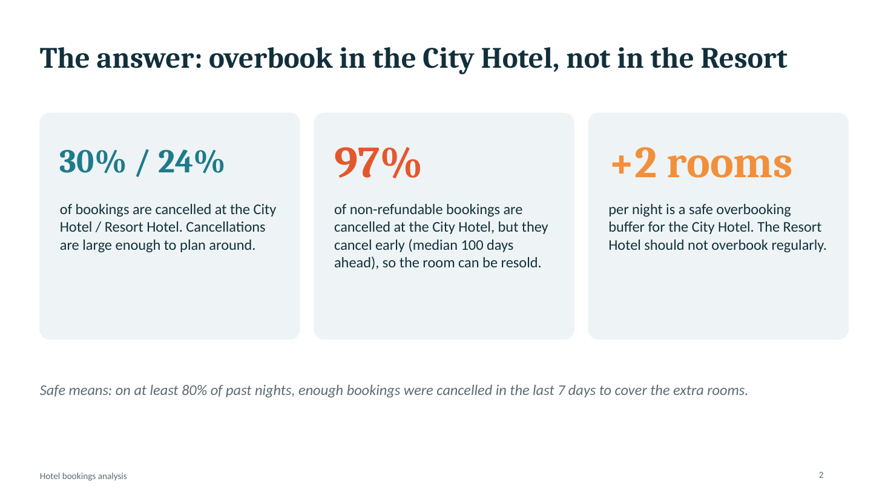
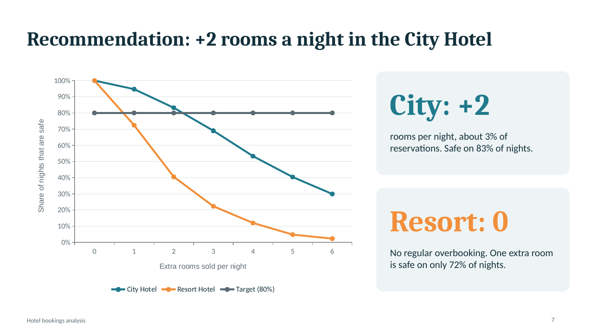

# Hotel Bookings: Cancellation and Revenue Analysis

An end-to-end analysis of two Portuguese hotels (a City Hotel and a Resort Hotel), from messy booking records to a data-backed recommendation for the manager.

**Question:** *Which bookings are most likely to be cancelled, how much revenue does that cost, and how many extra rooms can the hotel safely sell (overbooking)?*

## Key findings

- **Cancellations are large:** about 30% of City Hotel bookings and 24% of Resort Hotel bookings are cancelled.
- **The Resort Hotel follows the season:** its cancellation rate is 31% in June to August against 20% in the other months (chi-square test, p < 0.001).
- **Booking far ahead means more cancellations:** in the City Hotel, 11% of bookings made in the last week are cancelled, against 56% of those made 9 months or more ahead.
- **Non-refundable deposits cancel almost every time** (97% in the City Hotel, 84% in the Resort Hotel), but they cancel early (median 100 days before arrival in the City Hotel), so the room can be sold again.
- **Overbooking recommendation:** the City Hotel can sell up to **2 extra rooms per night** (safe on 83% of past nights). The Resort Hotel should not overbook regularly: one extra room was safe on only 72% of nights.

## What is in this repository

| File | Description |
|---|---|
| `hotel_analysis.ipynb` | The full analysis: cleaning, 8 business questions, hypothesis tests |
| `hotel_bookings_analysis.pdf` | Presentation slides (PDF) |
| `hotel_bookings_analysis.pptx` | Presentation slides (editable) |
| `images/` | Slide images used in this README |
| `requirements.txt` | Python packages |

## Data

The dataset is **not included** in this repository.

- **Where to get it:** the TidyTuesday project, week of 2020-02-11, "Hotel Bookings": [github.com/rfordatascience/tidytuesday/tree/main/data/2020/2020-02-11](https://github.com/rfordatascience/tidytuesday/tree/main/data/2020/2020-02-11) (file `hotels.csv`)
- **Original data:** Antonio, N., de Almeida, A., & Nunes, L. (2019). *Hotel booking demand datasets.* Data in Brief, 22, 41-49. [doi:10.1016/j.dib.2018.11.126](https://doi.org/10.1016/j.dib.2018.11.126)
- **Size:** 119,390 bookings and 32 columns, with arrivals from July 2015 to August 2017.

## How to run

1. Download `hotels.csv` from the link above and put it in the same folder as the notebook.
2. Install the packages: `pip install -r requirements.txt`
3. Open `hotel_analysis.ipynb` in Jupyter and run all cells from top to bottom.

## Method

1. **Cleaning:** removed contradictory records (for example, a completed stay with zero nights) and duplicates, leaving 86,224 of 119,390 rows. Every rule and its reason is written in the notebook.
2. **Exploration:** cancellation rates by month, lead time, deposit type, country, room change and customer type.
3. **Hypothesis tests:** chi-square tests for rates and Mann-Whitney for revenue, to check which differences are real and which could be chance.
4. **Recommendation:** bookings are grouped into risk tiers. The overbooking buffer is based on **late cancellations** (7 days or fewer before arrival), because a room cancelled months ahead can simply be sold again.

## Limitations

- Two hotels in one country, 2015 to 2017. Customer behaviour may have changed.
- There is no capacity or cost data, so the 80% target for "safe" nights is a business choice.
- "Late cancellation" is defined as 7 days or fewer before arrival. Other thresholds give other numbers.
- Duplicate rows were removed. Without a booking ID, some may be real group bookings, and this affects the rates.

## Next steps

- Build a model that predicts the cancellation of each booking.
- Test the overbooking rule on newer data.

## Author

[DraxeI](https://github.com/DraxeI)
